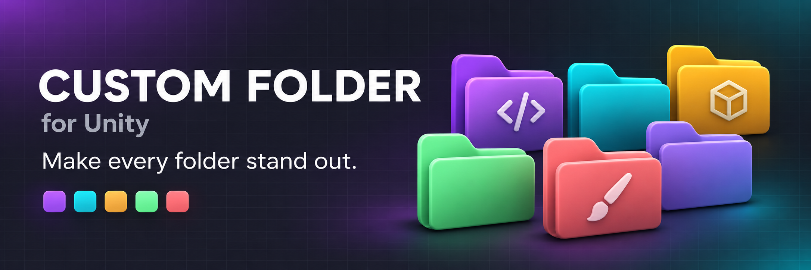

<a id="top"></a>

<p align="center">
  
</p>

<h1 align="center">Custom Folder for Unity</h1>

<p align="center">
  <strong>A little color. A clearer Project window.</strong><br>
  Custom folder colors, backgrounds, names, and icons — with quick editing and batch styling.
</p>

<p align="center">
  
</p>

<p align="center">
  <a href="#installation">🚀 Installation</a> &nbsp;·&nbsp;
  <a href="#features">✨ Features</a> &nbsp;·&nbsp;
  <a href="#quick-start">⚡ Quick start</a> &nbsp;·&nbsp;
  <a href="#screenshots">🖼️ Screenshots</a> &nbsp;·&nbsp;
  <a href="#guides">📖 Guides</a>
</p>

---

Give scripts, art, audio, and tools their own visual identity. **Custom Folder** lets you personalize folders directly in Unity's Project window, then manage their appearance from one place.

> [!NOTE]
> All customization runs inside the Unity Editor. The extension adds no runtime components to your scenes.

<a id="features"></a>

## ✨ Features

| Feature | What you can do |
| :--- | :--- |
| 🎨 **Independent colors** | Set folder, background, and name colors separately. Choose presets or randomize folder and background colors. |
| 🖼️ **Custom icons** | Use Unity Editor built-in icons or import your own PNG, JPG, and JPEG images. |
| ⚡ **Quick editing** | Open the Alt popup over a selected folder and adjust its appearance in place. |
| 🗂️ **Batch styling** | Edit multiple selected folders, or apply changes to all styled folders from the manager. |
| 🎛️ **Display controls** | Show or hide folder, background, and name colors while keeping saved styles. |
| 🔎 **Style Manager** | Search styled folders, rename folders, and organize imported icons in one window. |
| 🌐 **Five interface languages** | Choose English, Simplified Chinese, Traditional Chinese, Japanese, Korean, or automatic language detection. |
| 💾 **Saved styles** | Store colors, icons, and display settings in a project-local JSON file. |

<a id="installation"></a>

## 🚀 Installation

1. Download or clone this repository.
2. Copy the repository's **`Editor/custom folder`** directory into your Unity project's **`Assets/Editor/`** directory.
3. Open Unity and let the scripts finish compiling.
4. Select a folder in the Project window and follow the [quick start](#quick-start).

Your Unity project should contain:

```text
Assets/
└── Editor/
    └── custom folder/
        ├── CustomFolderProjectView.cs
        ├── CustomFolderStylePopup.cs
        └── ...
```

Keep the installed path as **`Assets/Editor/custom folder`**. The tool uses this location to save styles and imported icons.

<details>
<summary><strong>Unity version information</strong></summary>

Unity **2022.3.22f1 or later** is recommended. Script compilation has been checked against:

| Editor version | Validation |
| :--- | :--- |
| Unity `2022.3.22f1` | Compilation passed |
| Unity `6000.0.77f1` (Unity 6) | Compilation passed |

These checks validate compilation. Visual behavior still needs verification inside the Editor.

</details>

<a id="quick-start"></a>

## ⚡ Quick start

1. **Select** one or more folders in the Project window.
2. **Hover** the pointer over a selected folder and press <kbd>Alt</kbd>.
3. **Customize** its folder color, background, name color, or icon.
4. Click **OK** to save your changes.

| Popup action | Result |
| :--- | :--- |
| **OK** | Save the changes. |
| **Cancel** | Discard the current edits. |
| **Clear** | Remove all styles from the selected folders. |

The color checkboxes choose which color settings to apply. Selecting, importing, or removing an icon applies the icon automatically.

**Prefer a menu?** Right-click a selected folder and open **Assets → Custom Folder → Edit Style...**

<a id="screenshots"></a>

## 🖼️ In the Editor

### Project window

Colors and custom icons appear in the Project window's grid and folder tree.


<details>
<summary><strong>View the Alt popup and folder tree</strong></summary>

<table>
  <tr>
    <th align="left">Quick style editing</th>
    <th align="left">Folder tree</th>
  </tr>
  <tr>
    <td valign="top"></td>
    <td valign="top"></td>
  </tr>
</table>

</details>

### Style Manager

Browse styled folders, control display layers, and manage imported icons.


<a id="guides"></a>

## 📖 Guides

<details>
<summary><strong>🎛️ Manage styles and display layers</strong></summary>

Open **Tools → Custom Folder → Style Manager**.

| Area | Available actions |
| :--- | :--- |
| **Folder list** | Search, refresh, select all, clear selections, or select multiple styled folders. |
| **Editor panel** | Rename folders and edit colors, backgrounds, name colors, and icons. |
| **Apply changes** | Update selected folders or all styled folders. |
| **Remove styles** | Clear styles from selected folders or all styled folders. |
| **Imported Icons** | Import images, select icons, and delete selected imports. |
| **Language** | Choose an interface language or **Auto (Unity/OS)**. |

The **Display Layers** controls toggle `Folder Color`, `Background Color`, and `Name Color`. These switches preserve your saved styles.

The same switches are available from **Tools → Custom Folder → Display**.

</details>

<details>
<summary><strong>🖼️ Import and organize icons</strong></summary>

- Choose **Import Image...** in the Alt popup or Style Manager to import PNG, JPG, or JPEG files.
- Choose **Import Folder...** in the Style Manager to import multiple images from a directory.
- Use <kbd>Shift</kbd> + click to select multiple imported icons.
- Use **Select All**, **Clear Selection**, and **Delete Selected** to manage the library.

Imported images are processed for the Project window and stored in:

```text
Assets/Editor/custom folder/icon/
```

Deleting imported icons also clears their saved folder references.

</details>

<details>
<summary><strong>💾 Save and share folder styles</strong></summary>

Styles are saved in:

```text
Assets/Editor/custom folder/CustomFolderStyles.json
```

The file stores folder GUIDs, folder names and paths, colors, icon references, and global display settings. Folder moves and renames use Unity's GUIDs to keep the saved style associated with the folder.

To share styles with your team, commit **`CustomFolderStyles.json`**, the **`icon/`** directory, and Unity's corresponding **`.meta`** files to version control.

Keep the JSON file when updating the extension to retain your customizations.

</details>

<details>
<summary><strong>🧩 Repository layout</strong></summary>

```text
Editor/custom folder/       Unity Editor extension scripts
docs/images/                README banner and badges
docs/marketing/             Promotional banner and captions
README.md                   Setup and usage
LICENSE                     GPL-3.0 license
```

The repository's `Editor/custom folder` directory is copied into your Unity project's `Assets/Editor/` directory during installation. Style data and imported icons are stored in the Unity project after use.

</details>

<a id="notes"></a>

## 💡 Editor notes

- Click **Refresh** in the Style Manager if the Project window needs updating.
- Unity's script recompilation can close the Alt popup during a domain reload.
- Use **Assets → Custom Folder → Set Color** for quick color presets, or **Clear Style** to reset selected folders.

<a id="resources"></a>

## 🔗 Resources

- [Promotional banner and ready-to-post captions](docs/marketing/README.md)
- [Report an issue](https://github.com/ShadowsLunarfox/Custom-Folder-For-Unity/issues)
- [GPL-3.0 license](LICENSE)

---

<p align="center">
  <strong>Make your project easier to recognize, one folder at a time.</strong><br>
  <a href="#top">↑ Back to top</a>
</p>
