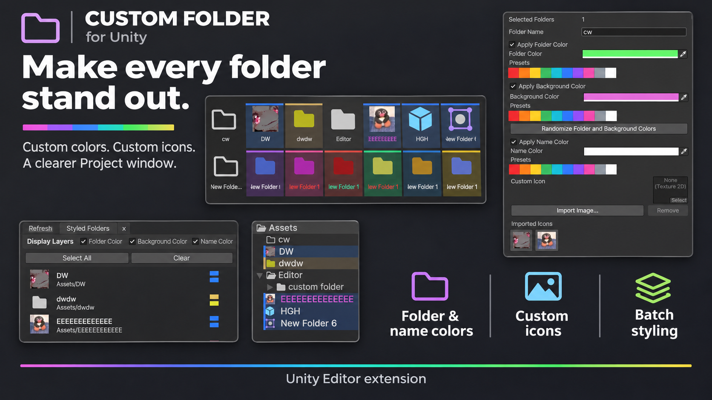

# Custom Folder promotional materials

[Download the banner](custom-folder-ad.png) · [View the repository](https://github.com/ShadowsLunarfox/Custom-Folder-For-Unity)

## Social post

**Make every folder stand out.**

Personalize your Unity Project window with Custom Folder: choose folder, background, and name colors, add your own icons, and style multiple folders at once. Keep your customizations organized with the Style Manager and make quick changes with the Alt popup.

Give your project a personal touch.

Get the tool: https://github.com/ShadowsLunarfox/Custom-Folder-For-Unity

\#Unity3D \#GameDev \#UnityTools \#IndieDev

## Short caption

Your folders, your style. Add custom colors and icons to your Unity Project window with Custom Folder.

https://github.com/ShadowsLunarfox/Custom-Folder-For-Unity

## Feature highlights

- Customize folder, background, and name colors independently.
- Use custom images or Unity Editor built-in icons.
- Style multiple folders at once.
- Edit quickly with the Alt popup.
- Manage styled folders and imported icons in the Style Manager.
- Choose English, Simplified Chinese, Traditional Chinese, Japanese, Korean, or automatic language detection.

## Banner details

The banner was generated with the built-in image generation tool using screenshots of Custom Folder as references. Use the screenshots in the main README to inspect the actual interface.
